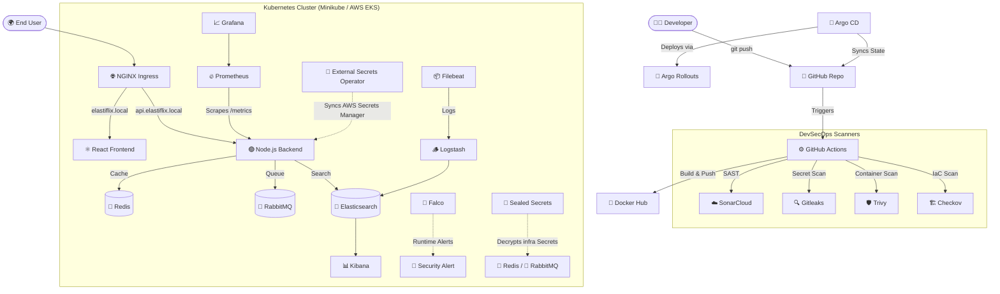

# 🎬 Elastiflix - Enterprise DevSecOps & GitOps Project


A production-grade, 3-tier application (React / Node.js / Elasticsearch) deployed using a fully automated DevSecOps and GitOps pipeline. This project demonstrates best practices in CI/CD, security, observability, and cloud-native architecture.

## 📸 Application Preview


## 🚀 Quick Start

Pick one workflow — all three run the same app:

### 1. Docker Compose (local ELK demo)

Requirements: Docker Desktop with **at least 8 GB** RAM, Python 3.

```bash
git clone https://github.com/An619/Elastiflix.git
cd Elastiflix
./start.sh
```

| Service | URL |
|---|---|
| Elastiflix | http://localhost:3000 |
| Kibana | http://localhost:5601 |
| Elasticsearch | http://localhost:9200 |

See [README-ELK.md](README-ELK.md) for the full Elastic Stack walkthrough and [LEARN.md](LEARN.md) for concepts.

### 2. Minikube + GitOps (local Kubernetes)

```bash
./bootstrap.sh
# then in an admin PowerShell:
#   minikube tunnel
```

Argo CD UI: http://argocd.local (`admin` / `admin123`).

### 3. AWS EKS (Terraform + Ansible)

```bash
cd terraform
terraform init
terraform apply
cd ..
ansible-playbook ansible/playbook.yml
```

## 🏗️ Architecture Diagram



> **Notes:** Prometheus scrapes only the Backend (`GET /metrics` in `backend/src/Backend.js`); the Frontend is a static nginx site with no metrics endpoint. SealedSecrets decrypt the infra Redis/RabbitMQ Secrets; the Backend Secret comes from ESO on EKS (or a plain Secret created by `bootstrap.sh` on Minikube).

## 📚 Docs

- [README-ELK.md](README-ELK.md) — Elastic Stack one-shot guide
- [FROM-SCRATCH.md](FROM-SCRATCH.md) — build the stack from scratch
- [LEARN.md](LEARN.md) — concepts and learning path

## ⚙️ Environment Variables

| Variable | Where | Purpose |
|---|---|---|
| `PUBLIC_HOST` | backend, frontend | Browser-reachable host for CORS / API URL (default `localhost`) |
| `ES_HOST` / `ES_INDEX` | backend | Elasticsearch endpoint and index |
| `REDIS_URL` or `REDIS_HOST` + `REDIS_PASSWORD` | backend | Redis cache (optional — backend runs without it) |
| `RABBITMQ_URL` or `RABBITMQ_HOST` + `RABBITMQ_PASSWORD` | backend | RabbitMQ events (optional) |
| `REDIS_PASSWORD` / `RABBITMQ_PASSWORD` | `bootstrap.sh`, Helm | Local Secret values — never commit real passwords |

## 🧪 Tests

```bash
cd backend && npm ci && npm test
cd ../frontend && npm ci --legacy-peer-deps && CI=true npm test -- --watchAll=false
cd ../terraform && terraform fmt -check -recursive && terraform init -backend=false && terraform validate
```
