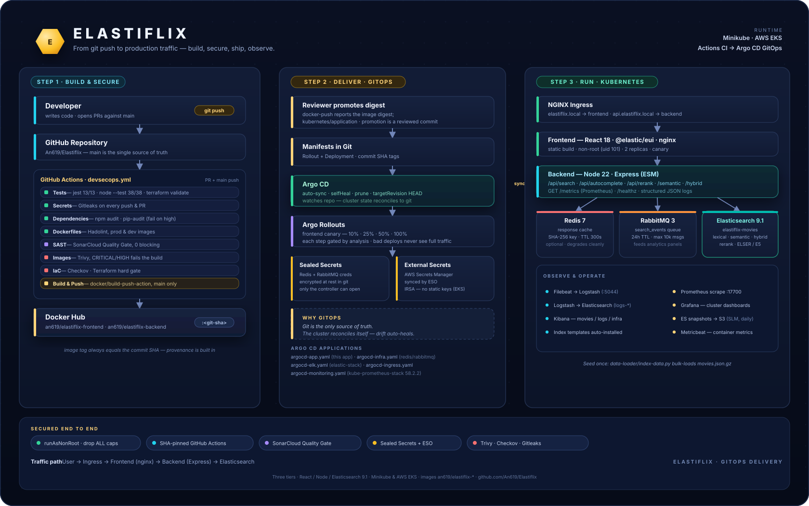

# 🎬 Elastiflix — Enterprise DevSecOps & GitOps Movie Search

[](https://github.com/An619/Elastiflix/actions/workflows/devsecops.yml)
[](https://sonarcloud.io/summary/new_code?id=An619_Elastiflix)
[](LICENSE)


Elastiflix is a **production-grade, 3-tier movie-search application** (React · Node.js · Elasticsearch) wrapped in a full **DevSecOps + GitOps** delivery pipeline: every commit is tested, scanned, containerized, promoted, and rolled out by declarative manifests — with observability, secrets management, and backups included. It runs the same on a laptop (Docker Compose or Minikube) and on AWS EKS.

> **Live traffic path:** User → NGINX Ingress → Frontend (nginx) → Backend (Express) → Elasticsearch
> **Deployment path:** `git push` → GitHub Actions (test · scan · build) → Docker Hub → bot bumps image tags → Argo CD syncs → Kubernetes (canary)

## 📸 Application Preview


---

## 🏗️ Architecture



### The flow, end to end

1. **A developer pushes** to a branch / opens a PR. `devsecops.yml` fans out to parallel gates: code tests, Gitleaks, dependency audits, Hadolint, SonarCloud, Trivy, Checkov.
2. **On merge to `main`** the same gates go green, then `docker-push` builds both images with `docker/build-push-action` and pushes them to Docker Hub tagged with the **commit SHA** (never `latest`).
3. The pipeline then **rewrites `image:` fields** in `kubernetes/application/` and commits them back with `[skip ci]`.
4. **Argo CD** (watching `HEAD` of this repo, automated sync + `selfHeal` + `prune`) detects the manifest diff and converges the cluster to it.
5. **Argo Rollouts** releases the new frontend gradually: **10% → 25% → 50% → 100%**, each step gated by an AnalysisRun on request volume and 5xx ratio. A failed analysis aborts and returns traffic to the stable Service.
6. At runtime, **NGINX Ingress** routes `elastiflix.local` → frontend and `api.elastiflix.local` → backend.
7. The **backend** serves search (lexical / semantic / hybrid / rerank), answers autocomplete, caches responses in **Redis**, publishes search analytics events to **RabbitMQ**, and exposes `/metrics` + `/healthz`.
8. **Observability** is wired in, not bolted on: Filebeat/Metricbeat → Logstash → Elasticsearch → Kibana for logs, Prometheus + Grafana for metrics, Velero + MinIO for backups.

> Search data model: the catalog (`data-loader/movies/movies.json.gz`) is bulk-indexed by `data-loader/index-data.py`, which derives the `user_score` facet from TMDB `vote_average` and pulls ELSER/E5 inference pipelines (`data-loader/config/`) so the same index serves BM25, vector semantic, hybrid, and reranked retrieval.

---

## 🧰 Tech Stack & Tools — what each one does and why

### 🎬 Application tier

| Tool | Used for | Why it's here |
|---|---|---|
| **React 18** | Frontend SPA | Component model for a faceted, instant-search UI |
| **@elastic/eui + react-search-ui** | Design system & search state | Elastic's own search framework — hosted search UI, facets, pagination, autocomplete out of the box |
| **react-router v5 · Sass · CRA** | Routing & styling | Routes (`/` → `/home`, search results) with scoped styles; Create React App toolchain |
| **NGINX** (`nginxinc/nginx-unprivileged`) | Frontend production host | Static file serving on **8080 as non-root**, relative `/api` proxying to the backend |
| **Node.js 22 · Express 4 (ESM)** | Backend API | Thin orchestration layer: query DSL → Elasticsearch → JSON; ES modules, `/healthz` for K8s probes |
| **@elastic/search-ui-elasticsearch-connector** | Query building | Translates `react-search-ui` state (filters, sort, pagination, queryConfig) into Elasticsearch DSL — no hand-written queries |
| **Structured JSON logging** (zero-dep) | Log pipeline feed | One JSON object per line — Filebeat can aggregate on `path`, `status`, `duration_ms`, `search_type` |

### 🔎 Search & data tier

| Tool | Used for | Why it's here |
|---|---|---|
| **Elasticsearch 9.1** | Search engine & document store | BM25 lexical search **plus** vector semantic (**ELSER / E5 `dense_vector`)**, hybrid retrieval, and reranking — one index (`elastiflix-movies`) serves all four modes |
| **Python `data-loader`** | Catalog ingestion | `index-data.py` bulk-indexes `movies.json.gz`, stringifies `id` for the keyword mapping, derives `user_score` from `vote_average`; unit-tested, 98% line coverage |
| **Logstash 9.1** | Ingest & transform | Parses/enriches app logs → indices; installs index templates (`logs-template`, `movies-template`) before ingesting |
| **Kibana 9.1** | Visualization | Ready-made movies / logs / infrastructure dashboards (`elk/`, `load-dashboards.sh`) |
| **Filebeat 9.1** | Log shipping | Reads container logs from `/var/lib/docker/containers`, ships to Logstash :5044 |
| **Metricbeat 9.1** | Metrics shipping | Container & host metrics + ~112 prebuilt dashboards into Kibana |
| **Redis 7** | Response cache | `SETEX search:<sha256>` keyed on the **full** `react-search-ui` state + `queryConfig`, 300 s TTL; backend **fails open** when Redis is down |
| **RabbitMQ 3** | Search-event bus | `search_events` queue carries `{term, count, ts}` — 24 h TTL, 10k-message cap, `drop-head` overflow so a silent consumer can't balloon the queue |

### ☁️ Platform & orchestration

| Tool | Used for | Why it's here |
|---|---|---|
| **Docker (multi-stage builds)** | Packaging | `frontend/Dockerfile.prod` (CRA build → unprivileged nginx), `backend/Dockerfile.prod` (deps → runtime, npm removed, `USER node`) |
| **Docker Compose** | Local one-shot ELK | Full stack + beats + app in one command (`start.sh`) — the fastest way to hack on this repo |
| **Kubernetes (Minikube / EKS)** | Container orchestration | Namespaces: `elastiflix`, `infra` (Redis/RabbitMQ), `elastic-stack`, `monitoring`, `argocd`, `velero` |
| **NGINX Ingress Controller** | Edge routing | Host-based rules: app, API, Kibana, Argo CD, Grafana, MinIO |
| **Argo Rollouts** | Progressive delivery | Frontend canary Rollout: `10% → 25% → 50% → 100%` with Prometheus-backed AnalysisRuns that abort on failure |
| **Helm** | Chart management | Infra values (`helm/elasticsearch`, `helm/redis`, `helm/rabbitmq`) + installs Argo CD, ESO, ALB controller, kube-prometheus-stack |

### 🔁 GitOps & delivery

| Tool | Used for | Why it's here |
|---|---|---|
| **Argo CD** | Continuous delivery | Watches `HEAD` (app-of-apps: `argocd-app/elk/infra/ingress/monitoring.yaml`); automated prune + self-heal — the cluster **pulls**, nothing is `kubectl apply`ed by hand |
| **Docker Hub** (`an619/elastiflix-*`) | Image registry | Immutable SHA-tagged images; GitOps commits the tag bump |
| **Sealed Secrets** | Encrypted secrets in git | Redis/RabbitMQ creds are sealed (`kubernetes/infra/*-sealedsecret.yaml`); only the in-cluster controller can decrypt |
| **External Secrets Operator** | Cloud secrets sync | EKS: syncs AWS Secrets Manager → K8s Secrets via **IRSA** (no static AWS keys); IRSA role scoped to `secret:elastiflix/*` |
| **GitHub Actions** | CI/CD engine | Reusable workflows fanned out by `devsecops.yml`; all third-party actions **pinned to commit SHAs** |
| **Velero + MinIO** | Backup & restore | Namespace `velero` backs up cluster state to S3-compatible MinIO (`minio.yaml`) |
| **Reviewed promotion** | GitOps trigger | `docker-push` publishes `<sha>`-tagged, signed images and reports their digests; promoting one into the manifests is a reviewed commit |

### 🛡️ DevSecOps & quality gates

| Gate | Tool | When | Failure behavior |
|---|---|---|---|
| Code tests | **Jest (frontend)** · **`node --test` + supertest (backend)** · **`terraform fmt -check` + `validate`** · **kubeconform `-strict`** · **actionlint** · **Ansible syntax check** | PR + main | build fails |
| Observability config | **`scripts/validate-observability.py`** — PromQL, dashboard JSON, selector wiring, runbook links | PR + main | build fails |
| Secret scanning | **Gitleaks** | PR + main | build fails |
| Dependency audit | **npm audit** (`--omit=dev`, prod only) · **pip-audit** | PR + main, high+ | build fails |
| Dockerfile lint | **Hadolint** (prod & dev Dockerfiles) | PR + main | build fails |
| SAST | **SonarCloud** — Quality Gate: 0 new issues, **≥ 80% coverage on new code**, 0% duplication | PR + main | build fails |
| Image scan | **Trivy** — CRITICAL/HIGH fixable CVEs | PR + main | build fails |
| IaC scan | **Checkov** — Terraform and Kubernetes are both **hard gates**; Kubernetes suppressions are per-resource annotations with a written reason | PR + main | build fails |
| Action hygiene | **SHA-pinned actions**, workflow-wide `contents: read`, per-job permissions, `docker-push` main-only and write-free | always | — |
| Supply chain | **SBOM + provenance** on every published image, **cosign** keyless signature, verified in the publishing job | main | build fails |
| Backup tooling | **`scripts/test-elasticsearch-snapshot.sh`** — mocked-HTTP tests of snapshot/restore safeguards | PR + main | build fails |

### 📊 Observability

| Tool | Scope |
|---|---|
| **kube-prometheus-stack 58.2.2** (Argo CD app) | Prometheus + Grafana; alertmanager disabled; namespace `monitoring`; Grafana served at `grafana.local` (Ingress) |
| **Backend `/metrics`** | Prometheus text exposition with bounded `route`/`status_class` labels, a latency histogram, cache/search/error counters and a Redis-reachability gauge |
| **SLO** | Proposed 99.5% / 7-day availability objective with multi-window burn-rate alerts, a metrics-missing alert, and Grafana dashboard (`kubernetes/monitoring/`) |
| **Alert delivery** | **Not configured** — Alertmanager is disabled pending an approved destination and owner. Alerts are visible in Prometheus/Grafana only |
| **Kibana dashboards** | Movies catalog explore, application logs, infrastructure health (`elk/`, `load-dashboards.sh`) |
| **Structured logs** | `level`, `service`, `path`, `status`, `duration_ms`, `search_type`, `cache_hit` per line |

### 🏗️ Infrastructure as code

| Tool | Used for |
|---|---|
| **Terraform** | AWS: VPC, **EKS** (managed node groups), IAM/**IRSA** roles (ESO, ALB controller), **private bastion** (no public IP, SSM access, HTTP egress only for APT), EKS OIDC. `terraform fmt -check` + `validate` run in CI; Checkov is the hard gate |
| **Ansible** | Cluster bootstrap: Helm repos → Argo CD → External Secrets Operator → ALB controller (IRSA ServiceAccount) |
| **AWS** | EKS, EC2 bastion, IAM/IRSA, Secrets Manager, VPC/NAT, ALB |
| **kubeseal** | Sealing infra secrets into `kubernetes/infra/*-sealedsecret.yaml` |

---

## 🚀 Quick Start

Pick one workflow — all three run the same app:

### 1. Docker Compose (local ELK demo, ~5 min)

Requirements: Docker Desktop with **≥ 8 GB** RAM, Python 3.

```bash
git clone https://github.com/An619/Elastiflix.git && cd Elastiflix
./start.sh        # generates elk/data/movies.ndjson, then compose up
```

| Service | URL |
|---|---|
| Elastiflix | http://localhost:3000 |
| Kibana | http://localhost:5601 |
| Elasticsearch | http://localhost:9200 |
| RabbitMQ management | http://localhost:15672 (`user` / `elastiflix-rabbit-pass`) |

See [README-ELK.md](README-ELK.md) for the Elastic Stack walkthrough and [LEARN.md](LEARN.md) for concepts.

### 2. Minikube + GitOps (local Kubernetes)

```bash
./bootstrap.sh            # minikube + Argo CD + apps + sealed secrets
minikube tunnel           # in a separate admin shell
```

Argo CD UI: http://argocd.local (`admin` / `admin123`) · App: http://elastiflix.local · API: http://api.elastiflix.local

### 3. AWS EKS (Terraform + Ansible)

```bash
cd terraform
terraform init && terraform apply        # VPC, EKS, IAM/IRSA, bastion
cd ..
ansible-playbook ansible/playbook.yml    # Argo CD, ESO, ALB controller
```

Then sync the Argo CD applications; everything else reconciles itself. See [FROM-SCRATCH.md](FROM-SCRATCH.md).

---

## 📂 Project layout

```
frontend/          React 18 SPA (@elastic/eui, react-search-ui) + nginx prod image
backend/           Express (ESM) API — search/semantic/hybrid/rerank + cache + events
data-loader/       Python bulk indexer for the movie catalog (+ config templates)
elk/               Filebeat · Metricbeat · Logstash (pipelines, index templates)
kubernetes/        application/ (Rollout, Deployment, HPA/PDB, NetworkPolicy) · infra/ · elastic-stack/
                   monitoring/ (ServiceMonitor, SLO rules, dashboard) · argocd-*.yaml (project + Applications)
                   namespaces/ (Pod Security Admission labels) · aws/
helm/              values for elasticsearch / redis / rabbitmq charts
terraform/         VPC · EKS · IAM/IRSA · ALB · bastion (private, SSM)
ansible/           Cluster bootstrap (Argo CD · External Secrets · ALB controller)
.github/workflows/ DevSecOps pipeline (reusable workflows + SHA-pinned actions)
```

## ⚙️ Environment variables

| Variable | Where | Purpose |
|---|---|---|
| `PUBLIC_HOST` | backend, frontend | Browser-reachable host for CORS / API URL (default `localhost`) |
| `ES_HOST` / `ES_INDEX` / `ES_API_KEY` | backend | Elasticsearch endpoint, index, optional API key |
| `REDIS_URL` *or* `REDIS_HOST` + `REDIS_PASSWORD` | backend | Redis cache; backend runs fine without it |
| `RABBITMQ_URL` *or* `RABBITMQ_HOST` + `RABBITMQ_USER`/`RABBITMQ_PASSWORD` | backend | Events to RabbitMQ; optional |
| `LOCAL` | backend | `true` enables CORS for the dev origins only |
| `REDIS_PASSWORD_FILE` / `RABBITMQ_PASSWORD_FILE` | backend (K8s) | Path to a mounted Secret file; the app refuses any path outside its allowlist. Passwords are no longer read from environment variables in-cluster |
| `REDIS_PASSWORD` / `RABBITMQ_PASSWORD` | `bootstrap.sh`, Docker Compose, local dev | Local-only values (`bootstrap.sh` generates random ones) — **never commit real passwords** |

## 🧪 Tests

```bash
# backend — 26 tests, supertest + in-memory module mocks (Redis/RabbitMQ)
cd backend && npm ci && npm run test:coverage      # lcov in backend/coverage/

# frontend — 13 tests (CRA/jest)
cd frontend && npm ci --legacy-peer-deps && CI=true npm test -- --watchAll=false

# data-loader — 8 tests, zero third-party deps required
cd data-loader && python3 test_index_data.py

# terraform
cd terraform && terraform fmt -check -recursive && terraform init -backend=false && terraform validate
```

CI enforces **≥ 80% coverage on new code** via the SonarCloud Quality Gate.

## 🔐 Security highlights

- Non-root containers everywhere (`USER node`, nginx-unprivileged), `runAsNonRoot`, `drop: [ALL]` capabilities, `allowPrivilegeEscalation: false`
- No public IPs on compute; the bastion lives in a **private subnet** and is reached via **AWS SSM** only (443 egress + HTTP/80 strictly for Ubuntu APT)
- Secrets: **Sealed Secrets** (in-git, encrypted) or **ESO + AWS Secrets Manager (IRSA)** — nothing plaintext in the repo; Gitleaks scans every push
- Supply chain: **SHA-pinned actions**, prod-only `npm audit`, **Trivy** image gate, **Checkov** IaC gate, **SonarCloud** SAST gate
- Least-privilege RBAC (`kubernetes/application/rbac`), per-tier namespaces, image tags bound to commit SHAs

## 📚 Docs

- [README-ELK.md](README-ELK.md) — Elastic Stack one-shot guide
- [FROM-SCRATCH.md](FROM-SCRATCH.md) — build the whole stack from zero
- [LEARN.md](LEARN.md) — concepts & learning path
- [DEMO.md](DEMO.md) — **interview / demo runbook**: 10-minute scripted walkthrough + likely Q&A
- [CHANGELOG.md](CHANGELOG.md) — what changed and why
- [CONTRIBUTING.md](CONTRIBUTING.md) — how to work on this repo (gates, layout, PR rules)
- [SECURITY.md](SECURITY.md) — vulnerability reporting & security posture
- [docs/adr](docs/adr/README.md) — architecture decision records (why GitOps, why SHA tags, why canary)

## 🤝 Contributing

See [CONTRIBUTING.md](CONTRIBUTING.md). Short version: PRs to `main` only, CI must be green (tests · audits · Hadolint · SonarCloud Quality Gate · Trivy · Checkov · Gitleaks · kubeconform), and all third-party actions are SHA-pinned. Security issues go to the private channel in [SECURITY.md](SECURITY.md), never to public issues.

## 📜 License

MIT — see [LICENSE](LICENSE).
